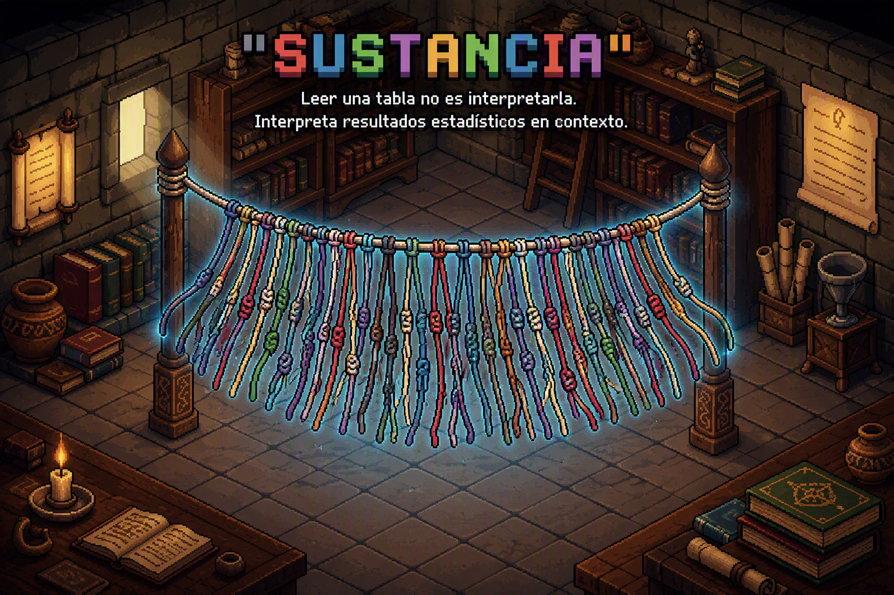

```{=html}
<div id="intro-splash" class="s3-intro" aria-label="Sustancia audiovisual introduction">
  <video id="intro-video" autoplay muted playsinline preload="auto" poster="../assets/portada sustancia.png" aria-label="Sustancia introduction video">
    <source src="../video_entrada.mp4" type="video/mp4">
  </video>
  <button type="button" id="btn-saltar-intro" class="s3-skip">Skip introduction →</button>
</div>
<noscript><style>#intro-splash{display:none!important}</style></noscript>
```

::: {.hero}


<div class="eyebrow">Sustancia · statistical learning laboratory · in development</div>

# Reading a table is not the same as interpreting it.

<p class="hero-sub"><strong>Sustancia</strong> is a web-based learning game that helps students interpret statistical results in context, across sociology, psychology, public policy, health, and other fields. The current prototype invites players to write their own interpretations and receive formative feedback. Its next stage explores an initial diagnostic, a multidimensional mastery profile, and activities that respond to students' learning trajectories.</p>
:::

<p class="v2-lead"><strong>Learning statistics means learning to think with data.</strong> Reaching a numerical result is not enough: we must also understand its meaning, question its limitations, and transfer what we have learned.</p>

<div class="v2-actions"><a href="como-funciona.qmd" class="v2-btn v2-primary">How learning will work →</a><a href="piloto.qmd" class="v2-btn">Explore the current prototype ↗</a></div>

## See the difference {.seccion}

These two responses refer to the same table from an empirical study on technology use and mental health among first-year university students. Both read the figures; only one relates them to the world.

<table class="demo-tabla">
<caption>Regression model: poorer mental health (illustrative excerpt)</caption>
<thead><tr><th>Predictor</th><th>β</th><th>p</th></tr></thead>
<tbody>
<tr><td>Compulsive use (IDA)</td><td>.38</td><td>&lt; .001</td></tr>
<tr><td>Gender (woman)</td><td>.24</td><td>.002</td></tr>
<tr class="fila-ns"><td>Screen time</td><td>.05</td><td>.41</td></tr>
</tbody>
</table>

::: {.comparacion}
<div class="carta carta-n1">
<span class="nivel-tag">LEVEL 1 · TECHNICAL READING</span>
<p>"Compulsive use and gender are statistically significant (p&nbsp;&lt;&nbsp;.05). Screen time is not statistically significant."</p>
<div class="veredicto">✓ A technically correct reading, but it does not yet explain the phenomenon. <strong>1 point.</strong></div>
</div>

<div class="carta carta-n3">
<span class="nivel-tag">LEVEL 3 · SUBSTANTIVE INTERPRETATION</span>
<p>"In this model, poorer mental health is associated less with <em>how long</em> students use screens than with <em>how</em> they use them: compulsive patterns, rather than exposure time alone, are associated with the outcome. A policy focused only on limiting screen hours could miss an important part of the issue."</p>
<div class="veredicto">✓ A richer interpretation: it connects the findings—including a non-significant result—to the research problem, without asserting causality. <strong>4 points.</strong></div>
</div>
:::

## Learning has multiple dimensions {.seccion}

A learner may get the calculation right but struggle to interpret it. Someone else may reason critically yet need more practice with procedures. Sustancia's proposed mastery profile therefore separates **concepts, operations, interpretive depth, recurring errors, and development over time**, rather than reducing learning to one grade.

<div class="v2-card-grid">
  <article class="v2-card"><span class="v2-kicker">01 · CONCEPTS</span><h3>What you understand</h3><p>Variables, measures, graphs, distributions, and statistical concepts at different levels of study.</p></article>
  <article class="v2-card"><span class="v2-kicker">02 · OPERATIONS</span><h3>What you can do</h3><p>Recognize, describe, calculate, compare, interpret, contextualize, critique, and transfer.</p></article>
  <article class="v2-card"><span class="v2-kicker">03 · INTERPRETATION</span><h3>How deeply you reason</h3><p>N1 technical reading; N2 statistical interpretation; N3 substantive interpretation; N4 critical reflection.</p></article>
  <article class="v2-card"><span class="v2-kicker">04 · LEARNING PATH</span><h3>How your thinking changes</h3><p>Initial responses, feedback, and revisions can provide fresh evidence of learning.</p></article>
</div>

[Explore two simulated mastery profiles →](pedagogia.qmd)

## From responding to revising {.seccion}

**The same learning cycle can support different kinds of reasoning.** Select a case—from social sciences, health, survey research, or engineering—and move through five stages. See how feedback can invite a learner to rethink an answer instead of receiving a ready-made conclusion.

```{=html}
<div class="s3-examples" data-s3-examples>
  <div class="s3-examples-top"><span class="v2-kicker">LABORATORY · FOUR CONTEXTS</span><span class="s3-example-counter" data-s3-example-counter>1 of 5 · simulated example</span></div>
  <div class="s3-example-choices" role="group" aria-label="Choose a statistical context">
    <button type="button" data-s3-example="ingresos" aria-pressed="true">Income</button>
    <button type="button" data-s3-example="salud" aria-pressed="false">Health</button>
    <button type="button" data-s3-example="encuestas" aria-pressed="false">Surveys</button>
    <button type="button" data-s3-example="ingenieria" aria-pressed="false">Engineering</button>
  </div>
  <div class="s3-example-timeline" role="group" aria-label="Explore the learning cycle">
    <button type="button" data-s3-stage="0" aria-pressed="true">1. Challenge</button>
    <button type="button" data-s3-stage="1" aria-pressed="false">2. Response</button>
    <button type="button" data-s3-stage="2" aria-pressed="false">3. Feedback</button>
    <button type="button" data-s3-stage="3" aria-pressed="false">4. Revision</button>
    <button type="button" data-s3-stage="4" aria-pressed="false">5. Evidence</button>
  </div>
  <div class="s3-example-panel" aria-live="polite">
    <span class="v2-kicker" data-s3-example-role>Learning challenge</span>
    <h3 data-s3-example-heading>Income and outliers · Social sciences</h3>
    <p data-s3-example-text>In a municipality, mean income is much higher than median income. What might this mean?</p>
    <button type="button" class="s3-next" data-s3-example-next>See the next stage →</button>
  </div>
  <p class="v2-small">Hypothetical demonstrations, not real student conversations or evidence of effectiveness. Students produce their own answers; the AI does not do that work for them.</p>
</div>
```

## How it is intended to work {.seccion}

The adaptive design envisages an **initial diagnostic**, a **multidimensional mastery profile**, curriculum-linked activity selection, and a guided revision cycle. Students begin by taking on challenges provided by the system; **they do not upload documents**. Course materials and exercises are reviewed by the academic team.

<div class="v2-actions"><a class="v2-btn v2-primary" href="como-funciona.qmd">Follow the student's journey →</a><a class="v2-btn" href="universidades.qmd">For universities →</a></div>

## The intellectual foundation {.seccion}

```{=html}
<div class="marco-layout">
  <div class="marco-texto"><div class="cita-marco">The project takes inspiration from Gilbert Simondon: learning statistics means more than operating techniques. It involves understanding the decisions that produce results, the assumptions behind them, and the conclusions they cannot support.</div></div>
  <div class="marco-video"><video autoplay loop muted playsinline class="video-chico" aria-label="Illustrative project video"><source src="../maya.mp4" type="video/mp4">Your browser does not support video.</video></div>
</div>
```

The prototype's original material comes from an empirical study of technological habitus and mental health among first-year university students (*n* = 276). The broader educational proposal now extends to statistical learning across disciplines.

## Project status {.seccion}

Not all components of Sustancia are available yet. The following distinctions separate what can be explored today from what is under design.

```{=html}
<div class="s3-status-grid">
  <article class="s3-status"><span class="s3-badge s3-now">AVAILABLE</span><h3>Shiny prototype</h3><p>Interpretation tasks and an initial approach to formative feedback.</p></article>
  <article class="s3-status"><span class="s3-badge s3-now">DOCUMENTED</span><h3>Pedagogical framework</h3><p>Error taxonomy, N1–N4, and the project's theoretical foundations.</p></article>
  <article class="s3-status"><span class="s3-badge s3-next-state">IN DEVELOPMENT</span><h3>Mastery profile</h3><p>Initial diagnostic and a multidimensional profile grounded in evidence.</p></article>
  <article class="s3-status"><span class="s3-badge s3-next-state">PLANNED</span><h3>Adaptation and dashboards</h3><p>Recursive feedback, activity selection, and tools for educators and institutions.</p></article>
</div>
```

[Read the theoretical foundations →](fundamentacion.qmd) · [Explore the pedagogical model →](pedagogia.qmd)

```{=html}
<script src="../assets/sustancia-interactions.js" defer></script>
```
