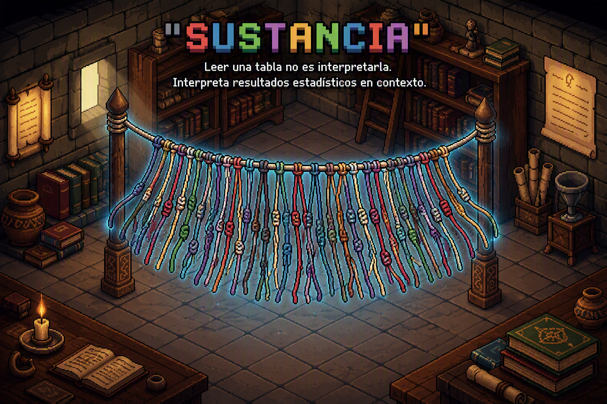

```{=html}
<div id="intro-splash" class="s3-intro" aria-label="Sustanciaren ikus-entzunezko aurkezpena">
  <video id="intro-video" autoplay muted playsinline preload="auto" poster="../assets/portada sustancia.png" aria-label="Sustanciaren aurkezpen-bideoa">
    <source src="../video_entrada.mp4" type="video/mp4">
  </video>
  <button type="button" id="btn-saltar-intro" class="s3-skip">Saltatu sarrera →</button>
</div>
<noscript><style>#intro-splash{display:none!important}</style></noscript>
```

::: {.hero}
<div class="eyebrow">Sustancia · ikaskuntza estatistikorako laborategia · garapen-fasean</div>

# Taula bat irakurtzea ez da hura interpretatzea.

<p class="hero-sub"><strong>Sustancia</strong> web-joko bat da, emaitza estatistikoak testuinguruan interpretatzen ikasteko: soziologian, psikologian, politika publikoetan, osasunean eta beste arlo batzuetan. Egungo prototipoan, ikasleek beren interpretazioak idatzi eta atzeraelikadura formatiboa jasotzen dute. Hurrengo fasean, hasierako diagnostikoa, dimentsio anitzeko gaitasun-profila eta ikaskuntza-ibilbidera egokitutako jarduerak garatu nahi dira.</p>

<p class="s3-opening-thesis">Arrazoibide estatistikoa ez da erantzun sinple batetik konplexu batera doan eskailera. Kontzeptuak, eragiketa estatistikoak, interpretazioa, irizpide kritikoa eta norberaren argudioak berrikusteko gaitasuna uztartzen ditu. Sustanciak dimentsio horietan batera nola ikasi aztertzen du.</p>

{.s3-hero-art alt="Sustancia proiektuaren ikusizko nortasuna"}
:::

<p class="v2-lead"><strong>Estatistika ikastea datuekin pentsatzen ikastea da.</strong> Emaitza lortzea ez da nahikoa: haren esanahia ulertu, mugak eztabaidatu eta ikasitakoa beste egoera batzuetara eraman behar da.</p>

<div class="v2-actions"><a href="como-funciona.qmd" class="v2-btn v2-primary">Ezagutu nola funtzionatuko duen →</a><a href="piloto.qmd" class="v2-btn">Aztertu egungo prototipoa ↗</a></div>

## Aldea da nork egiten duen lan intelektuala {.seccion #arquitecturas-aprendizaje}

IAk erantzun bukatua eman dezake, edo norberak egindako interpretazioa berrikusten lagundu. Sustanciak bigarren bidea proposatzen du: **sortu, atzeraelikadura jaso eta berriro pentsatu**.

```{=html}
<figure class="s3-architecture-art">
  
  <figcaption class="s3-architecture-captions">
    <p><strong>Erantzuna delegatu</strong>Emaitza ikaslearengandik kanpo pilatzen da; praktikatzeko aukera murrizten da.</p>
    <p><strong>Ikasitakoa barneratu</strong>Ikasleak sortu, berrikusi eta aplikatzen du; ezagutza bere baitan garatzen da.</p>
  </figcaption>
</figure>
```

[Ezagutu bi arkitekturen oinarriak →](fundamentacion.qmd)

## Arrazoibide estatistikoak hainbat dimentsio ditu {.seccion}

**Arrazoibide estatistikoa ez da trebetasun bakarra, eta ikaskuntza ez da denontzat ibilbide lineal bera.** Kontzeptuak ulertzea, prozedurak erabiltzea, ebidentziak interpretatzea, ziurgabetasuna aztertzea eta argudioak berrikustea eskatzen du.

**N1–N4 interpretazioaren sakontasuna deskribatzen duen ardatz bat da**, ez ikaskuntza osoaren lau mailako eskailera. Kalkulua zuzena izan daiteke baina interpretazioa ahula; edo interpretazioa zorrotza izan arren prozeduran laguntza behar izatea.

<div class="v2-card-grid">
  <article class="v2-card"><span class="v2-kicker">01 · KONTZEPTUAK</span><h3>Zer ulertzen duzu?</h3><p>Aldagaiak, neurriak, grafikoak, banaketak eta kontzeptu estatistikoak.</p></article>
  <article class="v2-card"><span class="v2-kicker">02 · ERAGIKETAK</span><h3>Zer egin dezakezu?</h3><p>Identifikatu, deskribatu, kalkulatu, alderatu, interpretatu, testuinguruan kokatu, kritikatu eta transferitu.</p></article>
  <article class="v2-card"><span class="v2-kicker">03 · INTERPRETAZIOA</span><h3>Zenbateraino sakontzen duzu?</h3><p>N1 irakurketa teknikoa; N2 interpretazio estatistikoa; N3 interpretazio substantiboa; N4 irakurketa kritikoa.</p></article>
  <article class="v2-card"><span class="v2-kicker">04 · IBILBIDEA</span><h3>Nola berrikusten eta garatzen duzu?</h3><p>Hasierako erantzunak, atzeraelikadurak eta berrikuspenek ikaskuntzari buruzko ebidentzia berria eman dezakete.</p></article>
</div>

[Aztertu bi profil simulatu eredu pedagogikoan →](pedagogia.qmd)

## Ikusi aldea {.seccion}

Konpara ditzagun **interpretazioaren sakontasunaren** bi adibide, erregresio-taula ilustratibo berarekin. Ez dute pertsona baten gaitasun osoa neurtzen, ezta nahitaezko N1 → N4 ibilbiderik adierazten ere.

<table class="demo-tabla">
<caption>Irakaskuntzarako erregresio-adibidea, asmatutako zifrekin; ez dira ikerketaren estimazio egiaztatuak.</caption>
<thead><tr><th>Aldagai azaltzailea</th><th>β</th><th>p</th></tr></thead>
<tbody><tr><td>Erabilera konpultsiboa (IDA)</td><td>.38</td><td>&lt; .001</td></tr><tr><td>Generoa (emakumea)</td><td>.24</td><td>.002</td></tr><tr class="fila-ns"><td>Pantaila-denbora</td><td>.05</td><td>.41</td></tr></tbody>
</table>

::: {.comparacion}
<div class="carta carta-n1">
<span class="nivel-tag">1. MAILA · IRAKURKETA TEKNIKOA</span>
<p>«Erabilera konpultsiboa eta generoa estatistikoki esanguratsuak dira (p&nbsp;&lt;&nbsp;.05). Pantaila-denbora ez da esanguratsua».</p>
<div class="veredicto">Irakurketa teknikoa: adierazitako esangura identifikatzen du, baina ez dio ikerketa-galderari erantzuten.</div>
</div>
<div class="carta carta-n3">
<span class="nivel-tag">3. MAILA · INTERPRETAZIO SUBSTANTIBOA</span>
<p>«Eredu ilustratibo honetan, erabilera konpultsiboak lotura positiboa du narriadurarekin; pantaila-denboraren koefizienteak, aldiz, ez du esangura estatistikorik lortzen. Horrek pantailak <em>nola</em> erabiltzen diren ikertzera gonbidatzen gaitu, zenbat erabiltzen diren aztertzeaz gain; baina ez du kausalitatea frogatzen».</p>
<div class="veredicto">Interpretazio substantiboa: emaitzak ikerketa-arazoarekin lotzen ditu eta ebidentziaren mugak aitortzen ditu.</div>
</div>
:::

<p class="s3-example-note"><strong>Zer erakusten du alderaketak?</strong> Interpretazioaren sakontasuna, ez pertsonaren maila orokorra. Emaitza ez-esanguratsu batek ez du efekturik eza frogatzen; korrelazioak ez du kausalitatea ezartzen.</p>

## Erantzunetik berrikuspenera {.seccion}

**Aukeratu lau testuinguruetako bat** eta aztertu ikaskuntza-zikloaren bost uneak. Sistemak ondorio bukatua eman beharrean galdera bat itzultzen duenean, erantzuna nola aldatzen den ikus dezakezu.

```{=html}
<div class="s3-examples" data-s3-examples>
  <div class="s3-examples-top"><span class="v2-kicker">LABORATEGIA · LAU TESTUINGURU</span><span class="s3-example-counter" data-s3-example-counter>1 / 5 · adibide simulatua</span></div>
  <div class="s3-example-choices" role="group" aria-label="Aukeratu testuinguru estatistikoa">
    <button type="button" data-s3-example="ingresos" aria-pressed="true">Diru-sarrerak</button>
    <button type="button" data-s3-example="salud" aria-pressed="false">Osasuna</button>
    <button type="button" data-s3-example="encuestas" aria-pressed="false">Inkestak</button>
    <button type="button" data-s3-example="ingenieria" aria-pressed="false">Ingeniaritza</button>
  </div>
  <div class="s3-example-timeline" role="group" aria-label="Ikaskuntza-zikloa aztertu">
    <button type="button" data-s3-stage="0" aria-pressed="true">1. Erronka</button>
    <button type="button" data-s3-stage="1" aria-pressed="false">2. Erantzuna</button>
    <button type="button" data-s3-stage="2" aria-pressed="false">3. Atzeraelikadura</button>
    <button type="button" data-s3-stage="3" aria-pressed="false">4. Berrikuspena</button>
    <button type="button" data-s3-stage="4" aria-pressed="false">5. Ebidentzia</button>
  </div>
  <div class="s3-example-panel" aria-live="polite">
    <span class="v2-kicker" data-s3-example-role>Jokoaren erronka</span>
    <h3 data-s3-example-heading>Diru-sarrerak eta muturreko balioak</h3>
    <p data-s3-example-text>Udalerri batean, batez besteko diru-sarrera mediana baino askoz handiagoa da. Zer esan nahi du horrek?</p>
    <button type="button" class="s3-next" data-s3-example-next>Ikusi hurrengo urratsa →</button>
  </div>
  <p class="v2-small">Adibide hipotetikoak dira; ez dira benetako elkarrizketak, eta ez dute eraginkortasuna frogatzen. Ikasleak sortzen du erantzuna, ez IAk.</p>
</div>
```

## Nola funtzionatuko du? {.seccion}

Proposatutako eredu egokitzaileak **hasierako diagnostikoa**, **gaitasun-profila**, curriculumari lotutako jarduerak eta berrikuspen gidatuaren zikloa uztartzen ditu. Ikasleak ez du dokumenturik igo behar: talde akademikoak aukeratu eta berrikusten ditu iturriak eta ariketak.

<div class="v2-actions"><a class="v2-btn v2-primary" href="como-funciona.qmd">Jarraitu ikaslearen ibilbideari →</a><a class="v2-btn" href="universidades.qmd">Unibertsitateetarako aplikazioak →</a></div>

## Oinarri teorikoa {.seccion}

```{=html}
<div class="marco-layout">
  <div class="marco-texto"><div class="cita-marco">Proiektuaren ikuspegi epistemologikoak Gilbert Simondon du inspirazio-iturri: estatistika ikastea ez da teknikak soilik erabiltzea, baizik eta emaitzak sortzeko erabakiak, haien aurresuposizioak eta ondoriozta ezin dena ulertzea.</div></div>
  <div class="marco-video"><video autoplay loop muted playsinline class="video-chico" aria-label="Sustancia proiektuaren bideo ilustratiboa"><source src="../maya.mp4" type="video/mp4">Zure nabigatzaileak ez du bideoa onartzen.</video></div>
</div>
```

Prototipoaren lehen datu-multzoa unibertsitateko lehen mailako ikasleen habitus teknologikoari eta osasun mentalari buruzko ikerketa enpiriko batetik dator (*n* = 276). Orain, proposamena beste diziplina batzuetako estatistika-materialetara zabaltzen ari da.

## Proiektuaren egoera {.seccion}

Proiektuaren osagai guztiak ez daude une berean erabilgarri. Etiketek erakusten dute zer dagoen gaur egun eta zer dagoen oraindik diseinuan.

```{=html}
<div class="s3-status-grid">
  <article class="s3-status"><span class="s3-badge s3-now">ERABILGARRI</span><h3>Shiny prototipoa</h3><p>Interpretazio-jarduerak eta hasierako ebaluazio formatiboa. Jokoaren interfazea gaztelaniaz dago.</p></article>
  <article class="s3-status"><span class="s3-badge s3-now">DOKUMENTATUTA</span><h3>Eredu pedagogikoa</h3><p>Akatsen sailkapena, N1–N4 eta oinarri teorikoa.</p></article>
  <article class="s3-status"><span class="s3-badge s3-next-state">GARAPENEAN</span><h3>Gaitasun-profila</h3><p>Hasierako diagnostikoa eta ebidentzietan oinarritutako dimentsio anitzeko profila.</p></article>
  <article class="s3-status"><span class="s3-badge s3-next-state">AURREIKUSITA</span><h3>Egokitzapena eta jarraipena</h3><p>Elkarrizketa errekurtsiboak, jardueren hautaketa eta irakasleentzako panelak.</p></article>
</div>
```

[Irakurri oinarri teorikoak →](fundamentacion.qmd) · [Aztertu eredu pedagogikoa →](pedagogia.qmd)

```{=html}
<script src="../assets/sustancia-interactions.js" defer></script>
```
