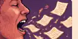

```{=html}
<div class="sed-portal">
  <header class="sed-salar" aria-label="Portada editorial de Sedimentos">
    
    <div class="sed-salar-copy">
      <span class="sed-eyebrow">Sustancia / Archivo editorial</span>
      <h1>Sedimentos</h1>
      <p>Depósitos de ideas, lecturas y hallazgos que se acumulan, se mezclan y dan nueva materia.</p>
      <a class="sed-jump" href="#ensayos">Explorar los ensayos ↓</a>
    </div>
    <a class="sed-mound-link" href="sedimento-01.html"><span>01 · Ensayo publicado</span><strong>Devorar el conocimiento ↗</strong></a>
  </header>
  <div class="sed-introduction">
    <p class="sed-eyebrow">Sobre Sedimentos</p>
    <p>Un archivo vivo de las ideas que dan forma a Sustancia. Reunimos ensayos, curiosidades y derivas intelectuales que alimentan el proyecto desde distintos lugares: la sociología, la pedagogía, el arte, la cultura latinoamericana, la materialidad tecnológica y la reflexión crítica.</p>
    <p class="sed-small">El paisaje se inspira en los salares del triángulo del litio. Los montículos de sales evocan la acumulación y transformación de la materia: una metáfora editorial, no una representación de litio puro.</p>
  </div>
  <section id="ensayos" class="sed-archive" aria-labelledby="sed-archive-title">
    <div class="sed-archive-head"><div><span class="sed-eyebrow">01 / Estratos del pensamiento</span><h2 id="sed-archive-title">Ensayos</h2></div><span class="sed-count">01 publicado</span></div>
    <!-- Cada nuevo ensayo se añade aquí con su número, fecha, imagen, bajada y enlace a su página independiente. -->
    <article class="sed-entry">
      <div class="sed-index" aria-hidden="true">01</div>
      <a class="sed-entry-art" href="sedimento-01.html" aria-label="Leer Devorar el conocimiento"></a>
      <div class="sed-entry-text"><p class="sed-eyebrow">Epistemología · Cultura · Noviembre 2026</p><h3><a href="sedimento-01.html">Devorar el conocimiento</a></h3><p class="sed-deck">De Pierre Bourdieu a la antropofagia cultural brasileña.</p><p>Apropiación, digestión y transformación del conocimiento como problema cultural, pedagógico y latinoamericano.</p><a class="sed-read" href="sedimento-01.html">Leer ensayo →</a></div>
    </article>
    <p class="sed-next-note">El archivo irá creciendo con nuevas publicaciones.</p>
  </section>
</div>
```
